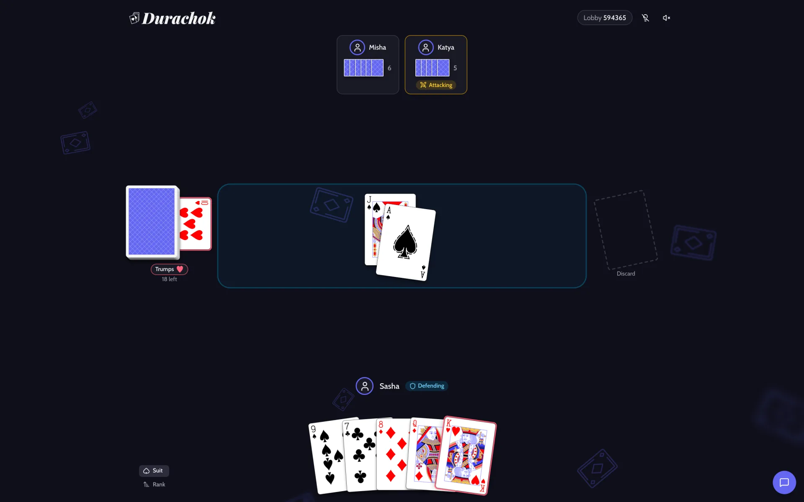
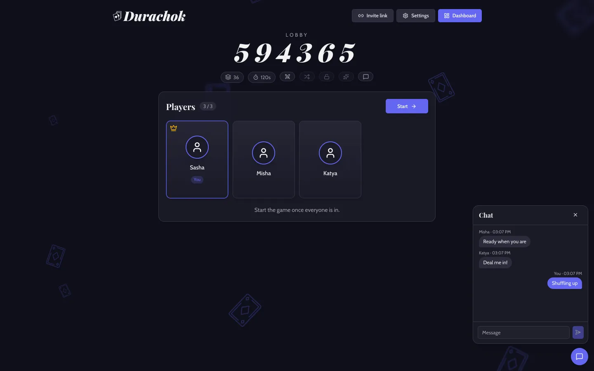
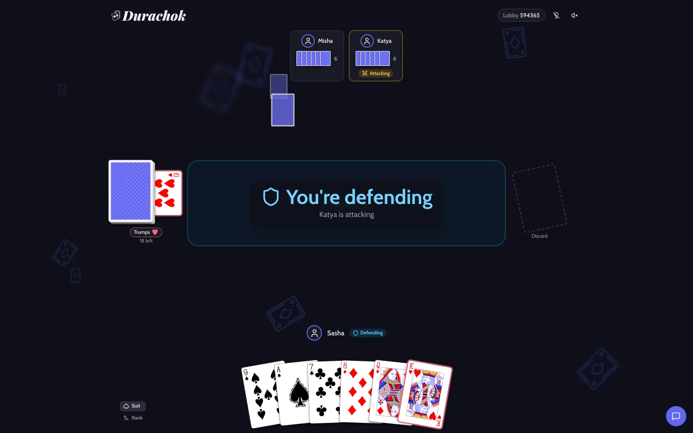
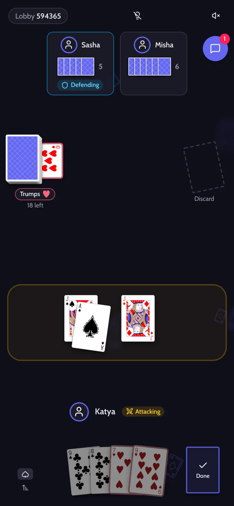
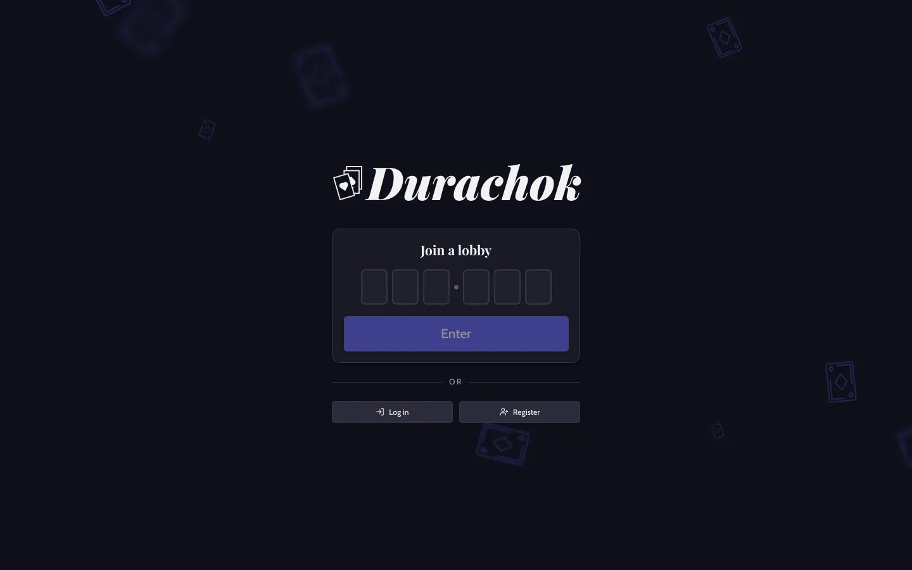
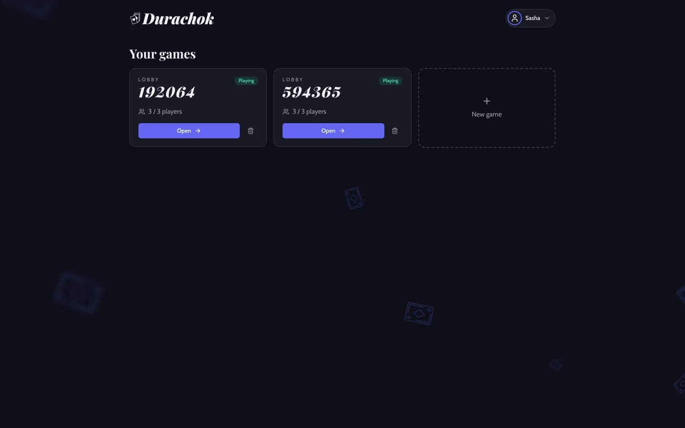

<div align="center">

# Durachok

**Durak, the Russian card game, in your browser.**<br />
Start a lobby, share the pin, and play with up to eight friends, on a computer or a phone.

[](https://github.com/feds01/durachok/actions/workflows/ci.yml)
[](https://bun.sh/)
[](https://www.typescriptlang.org/)
[](./LICENSE)



</div>

## Features

- **Lobbies with a pin.** Create a game, share its six-digit pin or invite link, and friends join with just a name, no account needed.
- **The whole game.** Attack, defend, pass the attack on with a card of the same rank, or take the cards, with a 36 or a 52 card deck.
- **A table that tells you what's going on.** It announces whether you attack or defend, and when the attack is passed on. Cards fly between the deck, the hands, the table and the discard pile, and each suit's trumps glow in their own colour.
- **Your hand, your way.** Sort it by suit or by rank, or drag the cards into your own order.
- **Mythic mode,** in which nobody is told how many cards anyone holds.
- **Chat** in the lobby, sounds, and tips for new players.

<table>
  <tr>
    <td width="38%"></td>
    <td width="38%"></td>
    <td width="24%" rowspan="2"></td>
  </tr>
  <tr>
    <td></td>
    <td></td>
  </tr>
</table>

## Getting started

You'll need [Bun](https://bun.sh/) 1.4 or later, [just](https://just.systems/) to run the project's commands, and
[pre-commit](https://pre-commit.com/) for the git hooks. MongoDB comes from [Docker](https://www.docker.com/), or use
your own (see the [server's README](./apps/server/README.md)).

```bash
just setup   # install the dependencies and the git hooks, and make sure MongoDB is running
just dev     # start the server and the web app
```

Before the first `just dev`, configure the environment of the [server](./apps/server/README.md) and of the
[web app](./apps/web/README.md).

## How it's built

| Package              | What it is                                                                         |
| -------------------- | ---------------------------------------------------------------------------------- |
| `apps/web`           | The game in the browser: React, Vite, Tailwind and framer-motion                   |
| `apps/server`        | The API and the game's sockets, on Bun, with tRPC, socket.io and MongoDB           |
| `packages/engine`    | The rules of the game, which the server plays by and the web app checks moves with |
| `packages/transport` | The types and schemas that the server and the web app send each other              |

## Commands

The commands are recipes in the [`justfile`](./justfile). Run `just` to list them.

| Command             | What it does                                                       |
| ------------------- | ------------------------------------------------------------------ |
| `just dev`          | Start the server and the web app in development mode               |
| `just db`           | Make sure the server can reach MongoDB, starting it if needed      |
| `just build`        | Build everything                                                   |
| `just test`         | Run every package's tests                                          |
| `just typecheck`    | Type check every package                                           |
| `just lint`         | Lint, or fix what can be fixed with `just lint --fix`              |
| `just fmt`          | Format, or check the formatting with `just fmt-check`              |
| `just architecture` | Check the architecture contracts in [`zenith.toml`](./zenith.toml) |
| `just ci`           | Run every check that CI runs                                       |

## Git hooks

`just setup` installs [pre-commit](https://pre-commit.com/) hooks, which check each commit's staged files with
[oxlint](https://oxc.rs/docs/guide/usage/linter), [oxfmt](https://oxc.rs/docs/guide/usage/formatter),
[zenith](https://github.com/feds01/zenith) and a type check. Install pre-commit with `brew install pre-commit` or
`pip install pre-commit`, and run the hooks on every file with:

```bash
pre-commit run --all-files
```

## Licence

[MIT](./LICENSE)
