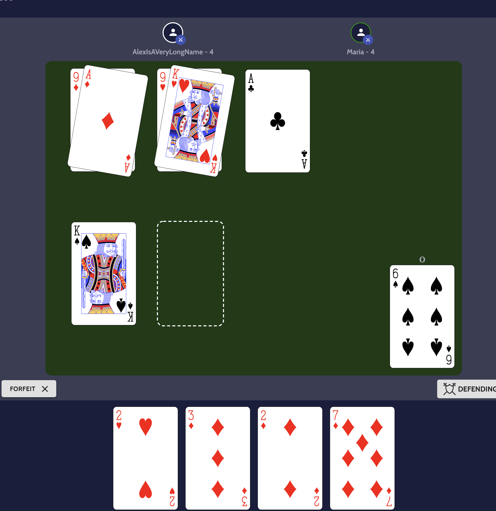

# Durachok



This is the repository that contains the sources to the Durachok game server, game client and the
library that is shared between the two.

## Structure

The repository is structured as follows:

- `apps/web` - The client for the game, a React application that serves as the client for the game.
- `apps/server` - The server for the game, a Bun application that serves as the server for the game.
- `packages/engine` - The shared library for the game, a TypeScript library that contains the shared code between the client and the server.
- `packages/transport` - Shared data transport types used for communication between client and server.

## Prerequisites

Before you begin, ensure you have the following installed:

- [Bun](https://bun.sh/) (v1.4 or later)
- [just](https://just.systems/), which runs the project's commands
- [Docker](https://www.docker.com/), for the MongoDB that `just setup` starts, or your own [MongoDB](https://www.mongodb.com/try/download/community) (see the [server README](./apps/server/README.md))

## Installation

1. Install the dependencies and the pre-commit hooks (see [Pre-commit Setup](#pre-commit-setup) below), and make sure MongoDB is running:

```bash
just setup
```

2. Configure the `apps/server` environment, read the [README.md](./apps/server/README.md) for more information.

3. Configure the `apps/web` environment, read the [README.md](./apps/web/README.md) for more information.

4. Run the following command to start the development server:

```bash
just dev
```

This will start the server and the client in development mode.

## Pre-commit Setup

This project uses [pre-commit](https://pre-commit.com/) to run linting, formatting, and type checking before each commit. This ensures code quality and consistency across the codebase.

### Installing pre-commit

**macOS (using Homebrew):**

```bash
brew install pre-commit
```

**Linux/macOS (using pip):**

```bash
pip install pre-commit
```

**Windows (using pip):**

```bash
pip install pre-commit
```

### Setting up the hooks

After installing pre-commit, `just setup` installs the git hooks, or run the following command from the repository root:

```bash
pre-commit install
```

### What the hooks do

The pre-commit configuration runs four checks on staged files:

1. **oxlint** - Lints JavaScript/TypeScript files and auto-fixes issues where possible
2. **oxfmt** - Formats JavaScript/TypeScript/JSON files
3. **zenith** - Checks the architecture contracts in [`zenith.toml`](./zenith.toml) with [zenith](https://github.com/feds01/zenith)
4. **typecheck** - Runs TypeScript type checking via `just typecheck`

### Running hooks manually

You can run the hooks manually on all files:

```bash
pre-commit run --all-files
```

Or run a specific hook:

```bash
pre-commit run oxlint --all-files
pre-commit run oxfmt --all-files
pre-commit run zenith --all-files
pre-commit run typecheck --all-files
```

### Skipping hooks (not recommended)

If you need to bypass the hooks for a specific commit:

```bash
git commit --no-verify -m "your message"
```

## Commands

The project's commands are recipes in the [`justfile`](./justfile). Run `just` to list them:

- `just dev` - Start all applications in development mode
- `just db` - Make sure the server can reach MongoDB, starting it in Docker if needed
- `just build` - Build all applications
- `just test` - Run tests across all packages
- `just typecheck` - Run TypeScript type checking
- `just lint` - Lint the code, or fix what can be fixed with `just lint --fix`
- `just fmt` - Format the code, or check it with `just fmt-check`
- `just architecture` - Check the architecture contracts in `zenith.toml`
- `just socket-client` - Regenerate the web app's socket client from the server
- `just ci` - Run every check that CI runs
